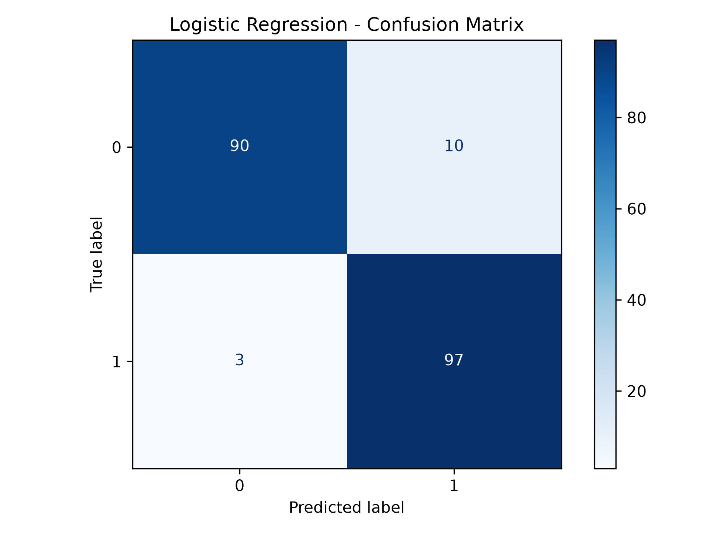
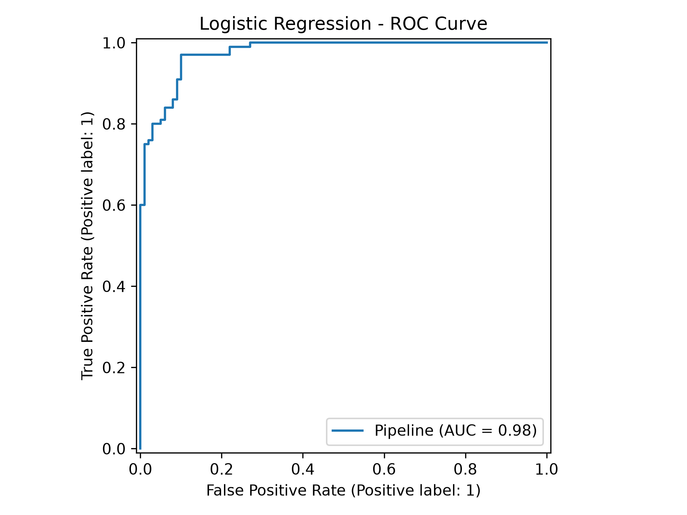

# Logistic Regression Classification

A binary classification machine learning project developed using Python and Scikit-learn. This project demonstrates a complete machine learning workflow, from synthetic data generation and preprocessing to model training, evaluation, threshold experimentation and visualisation.

## Project Overview

The objective is to build a Logistic Regression classifier that distinguishes between two classes using five numerical input features.

The project demonstrates practical understanding of supervised machine learning and model evaluation.

## Technologies Used

- Python 3.12
- NumPy
- Pandas
- Matplotlib
- Scikit-learn

## Project Structure

```text
machine_learning/
├── logistic_regression.py
├── logistic_regression_backup.py
├── confusion_matrix.png
├── roc_curve.png
└── README.md
```

## Machine Learning Workflow

### 1. Dataset Generation

Generated a synthetic binary classification dataset using Scikit-learn's `make_classification()`.

- Total observations: 1,000
- Input features: 5
- Target classes: 2
- Random state: 42

### 2. Data Inspection

Used Pandas to inspect:
- Dataset dimensions
- Sample observations
- Missing values
- Target class distribution

### 3. Data Splitting

Used an 80:20 training and testing split.

- Training observations: 800
- Testing observations: 200
- Stratified sampling to preserve class proportions

### 4. Feature Scaling and Model Training

Built a Scikit-learn Pipeline consisting of:

1. StandardScaler
2. LogisticRegression

The pipeline was fitted on the training data.

### 5. Model Evaluation

Evaluated the classifier using:

- Accuracy
- Precision
- Recall
- F1-score
- Confusion matrix
- ROC-AUC

### 6. Threshold Experimentation

Compared three classification thresholds:

| Threshold | Precision | Recall |
|---|---:|---:|
| 0.3 | 81.8% | 99.0% |
| 0.5 | 90.7% | 97.0% |
| 0.7 | 91.5% | 86.0% |

This experiment demonstrates the trade-off between precision and recall.

## Results

| Metric | Result |
|---|---:|
| Accuracy | 93.5% |
| Class 1 Precision | 90.7% |
| Class 1 Recall | 97.0% |
| ROC-AUC | Approximately 0.98 |

## Visualisations

### Confusion Matrix



### ROC Curve



## How to Run

Clone the repository and navigate to this project directory.

Create and activate a virtual environment:

```bash
python3 -m venv .venv
source .venv/bin/activate
```

Install dependencies:

```bash
pip install numpy pandas matplotlib scikit-learn
```

Run the project from the repository root:

```bash
python day03/machine_learning/logistic_regression.py
```

## Key Learnings

- Supervised machine learning and binary classification
- Logistic Regression
- Dataset inspection and preprocessing
- Train-test splitting
- Feature scaling
- Scikit-learn Pipelines
- Model evaluation metrics
- Classification threshold optimisation concepts
- Confusion matrix interpretation
- ROC curve and ROC-AUC
- Modular Python programming

## Limitations and Future Improvements

- The dataset is synthetic and does not represent a real-world prediction problem.
- Threshold tuning should be performed using a validation dataset, with the test set reserved for final evaluation.
- Compare Logistic Regression with additional classification algorithms.
- Explore cross-validation and hyperparameter tuning.
- Test the workflow on a real-world dataset.

## Author

Siddhant Kumar

GitHub: https://github.com/siddzz1702

Portfolio: https://siddzz1702.github.io
